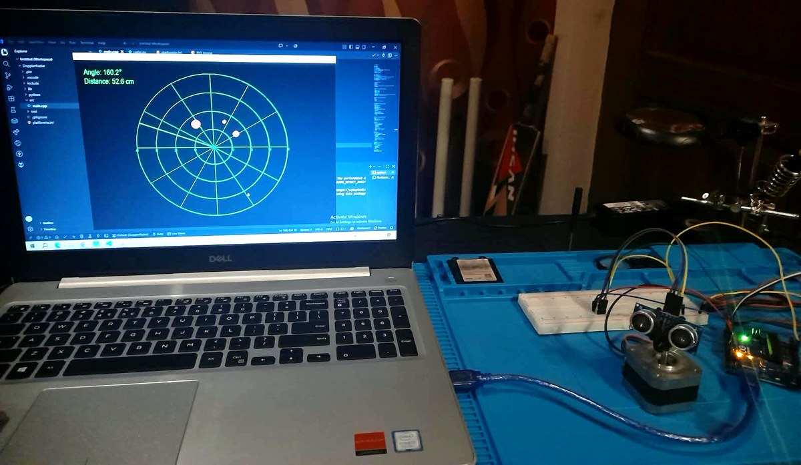
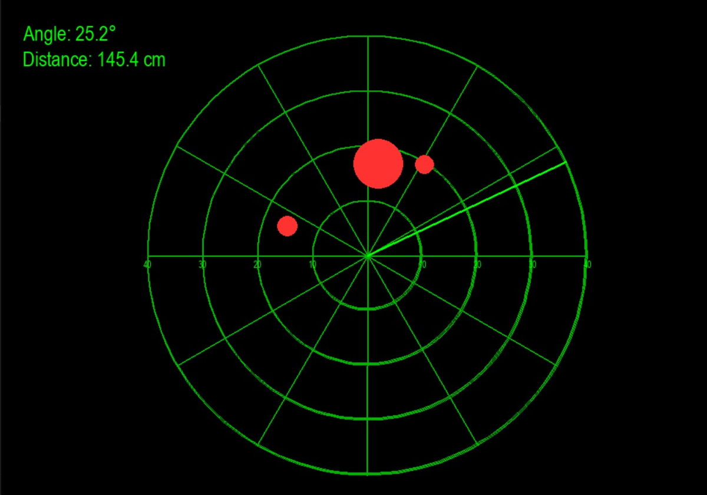
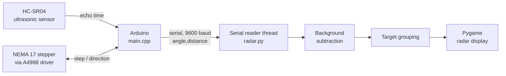
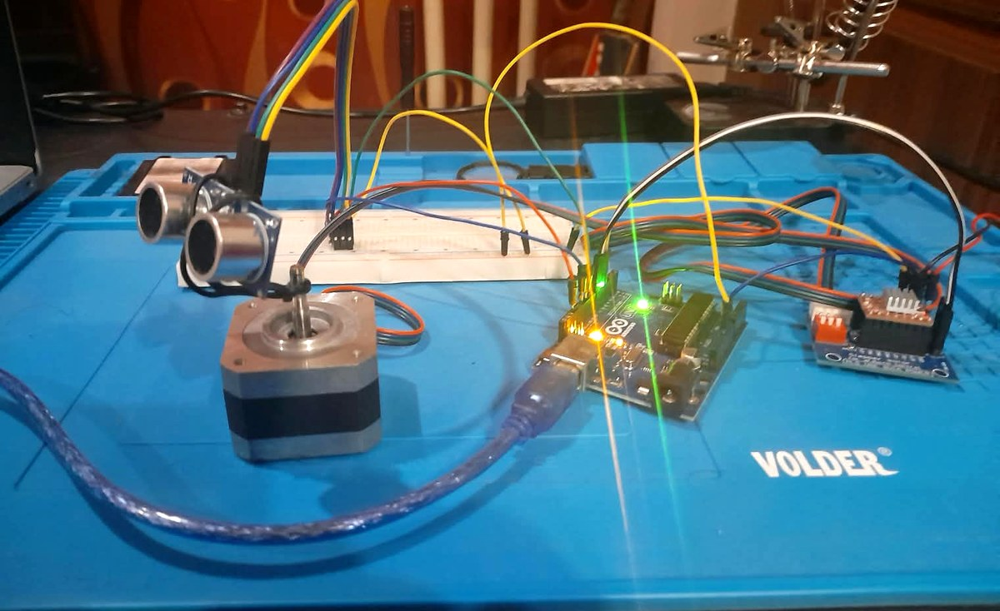

# Ultrasonic NEMA 17 Radar

A desktop radar built from an HC-SR04 ultrasonic sensor mounted on a NEMA 17 stepper motor. An Arduino sweeps the sensor through 180° or a full 360°, streams angle and distance readings over serial, and a Python/Pygame app draws them as a live radar screen. It maps the room first, then picks out only what has changed, with a range of about 4 m and accuracy of roughly ±5 mm.

<p align="center">
  
</p>
<p align="center"><em>The radar running, with the live display on the laptop and the sensor sweeping on the right.</em></p>

## Features

- **180° or 360° scanning** in 1.8° steps, about 5 seconds per 180° pass.
- **Range of about 4 m** with accuracy of roughly ±5 mm.
- **Spatial mapping** of the area around the sensor.
- **Background-difference detection.** On startup, the firmware scans the empty room once. The display then ignores anything within 20 cm of that baseline, so walls and furniture disappear and only new objects show up.
- **Target grouping.** Neighbouring readings at a similar distance are merged into one target. Each target is drawn as a single blip, sized by how wide it is across the sweep.
- **Noise-resistant target identification.** A target needs at least 3 consecutive readings, so a single stray echo is not drawn.
- **Live readout** of the current angle and distance, with "No Echo" when nothing comes back.
- **Threaded serial reader**, so the display stays smooth at 60 FPS while data arrives.

## Live display

<p align="center">
  
</p>
<p align="center"><em>Three objects picked up after background subtraction. Each blip's size reflects how wide the object is across the sweep.</em></p>

## How it works



1. **Calibrate.** At power-on, the Arduino does one forward sweep and sends a background distance for every step (`BG,step,distance`), then `BG_END`.
2. **Sweep.** It then sweeps back and forth forever, measuring at each step and sending `angle,distance`. A reading with no echo is sent as `-1`. There is a 3-second pause between cycles.
3. **Filter.** The Python app compares each reading with the background at the same step. Anything within 20 cm of the background is dropped.
4. **Group and draw.** The remaining points are split into targets wherever the distance jumps by more than 25 cm or the angle jumps by more than 2°. Each target becomes one red blip at its average distance.

### Measuring distance

The HC-SR04 sends a 10 µs ultrasonic pulse and times the echo. Distance is half the round trip at the speed of sound:

```
distance (cm) = echo time (µs) × 0.0343 / 2
```

Readings with no echo within 30 ms, or beyond 400 cm, are rejected.

## Hardware

| Part | Purpose |
| --- | --- |
| Arduino Uno | Runs the firmware, drives the motor and sensor |
| HC-SR04 ultrasonic sensor | Measures distance (rated 2–400 cm) |
| NEMA 17 stepper motor | Rotates the sensor in 1.8° steps |
| A4988 stepper driver | Drives the stepper from the Arduino |
| External motor power supply | Powers the stepper through the A4988 |
| Breadboard and jumper wires | Connections between the parts |

<p align="center">
  
</p>
<p align="center"><em>The HC-SR04 mounted on the stepper shaft, wired through a breadboard to the Arduino Uno and A4988 driver (right).</em></p>

### Wiring

| Arduino pin | Connects to |
| --- | --- |
| D7 | A4988 `STEP` |
| D6 | A4988 `DIR` |
| D5 | A4988 `EN` (held LOW to enable) |
| D10 | HC-SR04 `TRIG` |
| D11 | HC-SR04 `ECHO` |

## Software

| File | Runs on | Role |
| --- | --- | --- |
| `main.cpp` | Arduino | Motor control, distance measurement, background map, serial output |
| `radar.py` | PC | Serial reader, background subtraction, target grouping, Pygame display |

### Project structure

This is a PlatformIO project:

```
DopplerRadar/
├── src/
│   └── main.cpp        # Arduino firmware
├── python/
│   └── radar.py        # Pygame radar display
├── images/             # README photos
└── platformio.ini
```

### Serial protocol

```
Building background map...
BG,0,182.45
BG,1,181.90
...
BG,99,240.12
BG_END
Background map complete.
Beginning target detection...
178.2,183.1
176.4,-1
...
```

## Getting started

### 1. Flash the firmware

Open the project in VS Code with the PlatformIO extension and upload to the Arduino Uno. If you use the Arduino IDE instead, copy `main.cpp` into a new sketch.

### 2. Install the Python dependencies

```bash
pip install pyserial pygame
```

### 3. Set your serial port

In `radar.py`, change `SERIAL_PORT` to match your board, for example `COM5` on Windows or `/dev/ttyUSB0` on Linux.

### 4. Run the display

Keep the area in front of the radar clear for the first sweep while it maps the background, then run:

```bash
python python/radar.py
```

## Configuration

The values in the code are the ones used during testing. Change them to set the sweep angle and display range.

| Setting | File | Test value | What it does |
| --- | --- | --- | --- |
| `STEPS_180` | `main.cpp` | `100` | Steps per sweep (100 for 180°, 200 for 360°) |
| `MAX_DISTANCE_CM` | `main.cpp` | `400` | Readings beyond this are rejected |
| `MAX_DISTANCE` | `radar.py` | `40` | Display range in cm (outer ring); set up to `400` for the full range |
| `BACKGROUND_THRESHOLD` | `radar.py` | `20` | How far (cm) a reading must differ from the background to count |
| `DISTANCE_GAP_THRESHOLD` | `radar.py` | `25` | Distance jump (cm) that splits one target from the next |
| `MIN_TARGET_READINGS` | `radar.py` | `3` | Readings needed before a blip is drawn |

## Author

**Muhammad Muizz Sajid**: [GitHub](https://github.com/muizz-sajid) · [LinkedIn](https://www.linkedin.com/in/muhammad-muizz-sajid)
